  

### `~/projects`

<!-- projects:start -->
| project | what it does |
| --- | --- |
| [**repo-atlas**](https://github.com/cpldxx/repo-atlas) Python | Read a GitHub repo once and explore it as five layers, a mind map and answers from the code. Runs on your machine. |
| [**studynotch**](https://github.com/cpldxx/studynotch) Swift | A study helper that lives in your Mac's notch. Right-click a sentence and the AI you already use answers from your course's PDFs. |
| [**the-sovereign**](https://github.com/cpldxx/the-sovereign) Python | A research lab that never stops: give it a topic, it researches every night, keeps each fact with its source in a knowledge graph, and proves what it learned on an exam. Self-hosted, on local models or Claude. |
| [**catchbunny**](https://github.com/cpldxx/catchbunny) Python | Browser testers that prove a bug before they report it. An MCP server for coding agents. |
<!-- projects:end -->

The dashboard above redraws itself every day from GitHub's API · [how it's built](./scripts/build.py)
