<a href="https://cpldxx.github.io/cpldxx/"><picture><source media="(prefers-color-scheme: dark)" srcset="./assets/hero-dark.svg"><source media="(prefers-color-scheme: light)" srcset="./assets/hero-light.svg"></picture></a>

<picture><source media="(prefers-color-scheme: dark)" srcset="./assets/stats-dark.svg"><source media="(prefers-color-scheme: light)" srcset="./assets/stats-light.svg"></picture>

<a href="https://github.com/cpldxx/personal-site"><picture><source media="(prefers-color-scheme: dark)" srcset="./assets/project-personal-site-dark.svg"><source media="(prefers-color-scheme: light)" srcset="./assets/project-personal-site-light.svg"></picture></a>
<a href="https://github.com/cpldxx/studynotch"><picture><source media="(prefers-color-scheme: dark)" srcset="./assets/project-studynotch-dark.svg"><source media="(prefers-color-scheme: light)" srcset="./assets/project-studynotch-light.svg"></picture></a>
<a href="https://github.com/cpldxx/repo-atlas"><picture><source media="(prefers-color-scheme: dark)" srcset="./assets/project-repo-atlas-dark.svg"><source media="(prefers-color-scheme: light)" srcset="./assets/project-repo-atlas-light.svg"></picture></a>
<a href="https://github.com/cpldxx/the-sovereign"><picture><source media="(prefers-color-scheme: dark)" srcset="./assets/project-the-sovereign-dark.svg"><source media="(prefers-color-scheme: light)" srcset="./assets/project-the-sovereign-light.svg"></picture></a>

<a href="https://cpldxx.github.io/cpldxx/"><b>Open the interactive version ↗</b></a> redrawn every night from the GitHub API · <a href="./scripts/build.py">how it's built</a>

